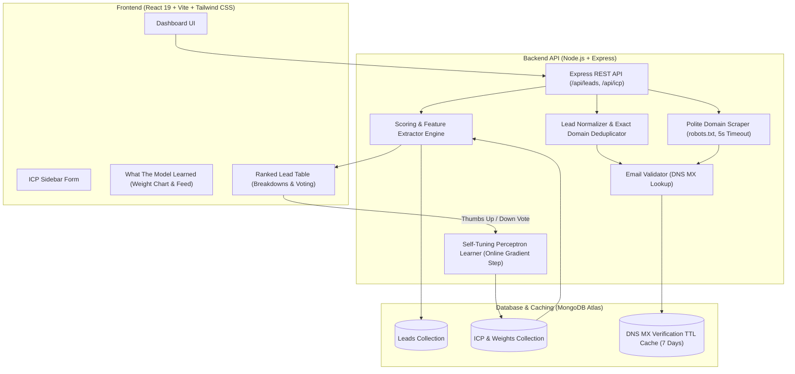

# Caprae LeadLens

> **A lead list that learns what a good lead means for your team in about a dozen clicks.**

[](https://nodejs.org)
[](https://expressjs.com)
[](https://react.dev)
[](https://vitejs.dev)
[](https://www.mongodb.com/atlas)
[](https://tailwindcss.com)

---

## 📌 Problem & Business Use Case

Lead scraping is a commodity. Tools like SaaSquatch can pull thousands of raw domains and contacts in minutes. However, the bottleneck for high-velocity sales teams is not *getting* leads—it is **prioritizing and trusting leads**:
1. **Noisy, unranked lead lists**: SDRs waste hours manually skimming through generic lead spreadsheets.
2. **Static, rigid ICP rules**: Traditional filters (e.g. "SaaS only") miss nuance in decision maker titles, employee sizes, and strategic keywords.
3. **Black-box AI mistrust**: Sales reps reject opaque scoring algorithms when they cannot see *why* an account is scored high or low.
4. **Deliverability risks**: Dirty email lists trigger spam traps and damage sender reputation.

**Caprae LeadLens** solves this by turning raw lead lists into an **interactive, self-tuning prioritization engine**:
- Ingests leads 3 ways (CSV upload, 200 instant sample leads, or polite live domain scraping).
- Normalizes and deduplicates leads by exact domain, keeping the most complete records.
- Verifies business emails via DNS MX lookups with MongoDB TTL caching.
- Evaluates leads against an Ideal Customer Profile (ICP) with **100% transparent scoring breakdowns**.
- **Learns in ~12 clicks**: Uses an online perceptron learning algorithm to adapt feature weights dynamically from SDR thumbs up/down feedback.

---

## 🏗️ Architecture Diagram



---

## 🛠️ Exact Tech Stack & Architecture Rationale

| Layer | Technology | Rationale & Tradeoffs |
|---|---|---|
| **Backend** | Node.js (ESM) + Express | Lightweight, event-driven I/O ideal for non-blocking asynchronous DNS lookups, CSV streaming, and fast web requests. |
| **Database** | MongoDB Atlas (Mongoose) | Flexible document schema accommodates varying enrichment fields (social links, custom metadata, dynamic feature breakdowns) without rigid table migrations. |
| **Caching** | MongoDB TTL Indexes | Zero extra infrastructure footprint. Email verification results expire automatically after 7 days via `{ expireAfterSeconds: 604800 }`. |
| **Frontend** | React 19 (Vite) + Tailwind CSS | Sub-second hot-module reloading, ultra-responsive UI state transitions when re-ranking leads, and atomic styling with zero runtime CSS overhead. |
| **Machine Learning** | Hand-written JavaScript Perceptron | Zero heavy Python/ML dependencies (`tensorflow`, `scikit-learn`). Sub-millisecond weight updates and re-scoring directly inside Node.js event loop. |
| **Hosting (Target)** | **Render** (API Server) + **Vercel** (Vite SPA Client) | Standard industry deployment: static CDN edge caching on Vercel for frontend, managed containerized Node.js service on Render, managed cloud cluster on MongoDB Atlas. |

---

## 🧠 Scoring & Self-Tuning Learner (Plain Language)

### 1. Binary Feature Extraction
Each lead is evaluated against the active Ideal Customer Profile (ICP) across 6 binary features ($x_i \in \{0, 1\}$):
- **`industryMatch` (1/0)**: Matches target industries (e.g. SaaS, Fintech, AI/ML).
- **`sizeMatch` (1/0)**: Employee count falls within ICP target range (e.g. 20 - 500).
- **`regionMatch` (1/0)**: Location matches target geographic markets (e.g. North America, Europe).
- **`seniorityMatch` (1/0)**: Contact title reflects decision maker authority (C-level, VP, Director, Founder).
- **`keywordMatch` (1/0)**: Company description or title contains strategic keywords (`#b2b`, `#ai`, `#cloud`).
- **`emailVerified` (1/0)**: Domain has active DNS MX mail exchange records.

### 2. Normalized Score Calculation
The score is computed as the normalized weighted sum of active features:
$$\text{Score} = \text{round}\left( \frac{\sum_{i=1}^6 w_i \cdot x_i}{\sum_{i=1}^6 \max(w_i, 0.1)} \times 100 \right)$$
- Always produces a predictable, normalized score between **0 and 100**.
- Generates human-readable breakdown tags: e.g. `+25 Industry fit`, `+20 Decision maker seniority`, `+0 (no target region)`.

### 3. Online Perceptron Update Rule
When an SDR casts a vote (Thumbs Up: $y = 1.0$, Thumbs Down: $y = 0.0$):
1. **Prediction Error**:
   $$e = y - \hat{y} \quad \text{where} \quad \hat{y} = \frac{\text{Score}}{100}$$
2. **Weight Delta**:
   $$\Delta w_i = \text{round}(\eta \cdot e \cdot x_i) \quad (\text{Learning rate } \eta = 6.0)$$
3. **Weight Clamping**:
   $$w_i^{\text{new}} = \min(50, \max(5, w_i^{\text{current}} + \Delta w_i))$$
- Weights are strictly clamped between **5 and 50 points** to prevent any single feature from becoming runaway dominant or collapsing to zero.
- **Auditable Change Notes**: Logs human-readable diffs (e.g. *"Industry weight raised from 25 to 31 (+6) based on your feedback"*).
- The entire dataset is re-scored and re-ranked in MongoDB within milliseconds.

---

## 🗄️ Database Schema

### `Lead` Collection
```typescript
{
  company: string;            // e.g. "CloudScale Systems"
  domain: string;             // Indexed exact domain (e.g. "cloudscalesystems.io")
  industry: string;           // e.g. "SaaS"
  employeeCount: number;      // e.g. 140
  location: string;           // e.g. "San Francisco, CA"
  region: string;             // e.g. "North America"
  contactName: string;        // e.g. "Sarah Jenkins"
  title: string;              // e.g. "Chief Technology Officer"
  email: string;              // e.g. "sjenkins@cloudscalesystems.io"
  description: string;        // Company bio snippet
  socialLinks: string[];      // Public LinkedIn/Twitter links
  source: 'csv' | 'sample' | 'paste';
  confidence: 'High' | 'Medium' | 'Low';
  emailVerified: boolean;
  features: {
    industryMatch: 0 | 1;
    sizeMatch: 0 | 1;
    regionMatch: 0 | 1;
    seniorityMatch: 0 | 1;
    keywordMatch: 0 | 1;
    emailVerified: 0 | 1;
  };
  score: number;              // 0 - 100
  breakdown: string[];        // ['+25 Industry fit', '+20 Seniority level']
  userVote: 1 | 0 | null;     // User feedback
  voteTimestamp: Date | null;
  createdAt: Date;
  updatedAt: Date;
}
```

### `Icp` Collection
```typescript
{
  name: string;
  targetIndustries: string[];
  companySize: { min: number; max: number };
  targetRegions: string[];
  targetSeniority: string[];
  targetKeywords: string[];
  weights: {
    industryMatch: number;    // default: 25
    sizeMatch: number;        // default: 20
    regionMatch: number;      // default: 15
    seniorityMatch: number;   // default: 20
    keywordMatch: number;     // default: 10
    emailVerified: number;    // default: 10
  };
  learningRate: number;       // default: 6.0
  totalVotes: number;
  upVotes: number;
  downVotes: number;
  changeHistory: [{
    timestamp: Date;
    leadDomain: string;
    company: string;
    vote: number;
    previousWeights: object;
    newWeights: object;
    notes: string[];
  }];
}
```

### `EmailVerificationCache` Collection (TTL Index)
```typescript
{
  domain: string;             // Unique, indexed
  hasMx: boolean;
  mxRecords: string[];
  checkedAt: Date;            // TTL expiration: 7 days
}
```

---

## 🚀 Setup Instructions (Local Development)

### Prerequisites
- Node.js v20+ and npm v10+
- (Optional) MongoDB local or MongoDB Atlas URI. *If no URI is supplied, the server automatically starts a zero-config in-memory MongoDB sandbox!*

### Step 1: Clone and Install
```bash
git clone https://github.com/your-username/leadlens.git
cd leadlens

# Install server dependencies
cd server
npm install

# Install client dependencies
cd ../client
npm install
```

### Step 2: Configure Environment Variables
Create `.env` inside `server/` (or copy `.env.example`):
```env
PORT=5000
MONGODB_URI=mongodb://127.0.0.1:27017/caprae_leadlens
NODE_ENV=development
CLIENT_URL=http://localhost:5173
```

Create `.env` inside `client/` (optional for local dev):
```env
VITE_API_URL=http://localhost:5000/api
```

### Step 3: Run Unit Tests
```bash
cd server
npm test
```
*Output: All 5 scoring, feature extraction, and perceptron weight update tests pass.*

### Step 4: Launch Development Servers
In Terminal 1 (Backend API):
```bash
cd server
npm run dev
```

In Terminal 2 (Frontend Client):
```bash
cd client
npm run dev
```
Open **`http://localhost:5173`** in your browser.

---

## 🌐 Production Deployment Guide

### 1. MongoDB Atlas Setup
1. Create a free M0 cluster on [MongoDB Atlas](https://www.mongodb.com/atlas).
2. Create a database user and allow access from `0.0.0.0/0` (or Render's IP range).
3. Copy your connection URI: `mongodb+srv://<user>:<password>@cluster0.mongodb.net/caprae_leadlens?retryWrites=true&w=majority`.

### 2. Render Deployment (Backend API)
1. Link your GitHub repository to [Render](https://render.com).
2. Create a new **Web Service**:
   - **Root Directory:** `server`
   - **Build Command:** `npm install`
   - **Start Command:** `npm start`
3. Add Environment Variables:
   - `PORT`: `5000`
   - `NODE_ENV`: `production`
   - `MONGODB_URI`: `<Your MongoDB Atlas URI>`
   - `CLIENT_URL`: `https://your-leadlens-app.vercel.app`
4. Deploy and copy your backend service URL (e.g., `https://caprae-leadlens-api.onrender.com`).

### 3. Vercel Deployment (Frontend SPA)
1. Import your GitHub repository to [Vercel](https://vercel.com).
2. Set **Root Directory** to `client`.
3. Framework Preset: **Vite**.
4. Add Environment Variable:
   - `VITE_API_URL`: `https://caprae-leadlens-api.onrender.com/api`
5. Click **Deploy**.

---

## 📈 How I'd Scale This

While this MVP is optimized for rapid local demoing and small team lead lists, here is the roadmap for enterprise production scale:

1. **Distributed Job Queues (Redis + BullMQ)**:
   - Move web crawling and DNS MX resolution into background worker queues with configurable rate limiting per target domain.
2. **Proxy Pool Rotation & CAPTCHA Mitigation**:
   - Integrate rotating residential proxy networks (e.g., BrightData/Oxylabs) with automatic backoff retry policies and headless browser orchestration (Playwright cluster) for JavaScript-heavy single-page sites.
3. **Robots.txt & Polite Crawling Compliance**:
   - Centralize robots.txt parsing in Redis cache with token-bucket rate limiting (max 1 req / 2s per domain) and respectful User-Agent headers.
4. **Hierarchical Multi-Tenant Learning**:
   - Segment perceptron weights per organization, sales team, or individual SDR campaign, allowing distinct sub-models for Enterprise vs. Mid-Market outbound motions.

---

## ⚖️ Ethics & Data Privacy

> **Ethics Statement:**  
> Caprae LeadLens operates exclusively on public corporate web metadata and user-provided lead inputs. It strictly adheres to `robots.txt` directives, enforces 5-second request timeouts with polite concurrency limits, never bypasses authentication mechanisms, and never scrapes login-walled platforms such as LinkedIn.

---

## ⚠️ Known Limitations

1. **Exact Domain Deduplication**: Deduplication matches strictly on exact domain name (`stripe.com`). Fuzzy company name matching (e.g., "Stripe Inc" vs "Stripe Payments") is omitted by design to prevent false positive record merges.
2. **Static HTML Scraper**: The built-in domain scraper reads server-rendered HTML and OpenGraph meta tags. Single-page applications requiring heavy client-side JavaScript hydration will fall back to extracting meta title/domain information.
3. **Single-User Scope**: All votes train the active shared ICP profile without multi-user tenant authentication.

